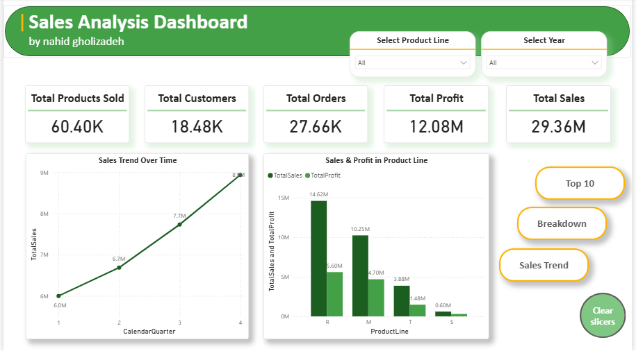

# AdventureWorks Sales Dashboard (Power BI)

## 📌 Project Overview
This project showcases a complete end-to-end data analysis workflow using **Power BI**, built upon the well-known **AdventureWorksDW2017** database. The objective was to transform raw transactional data into an interactive, multi-page executive dashboard that provides deep insights into sales performance, product profitability, and customer behavior.

The project demonstrates proficiency in the entire Business Intelligence (BI) lifecycle: Data Cleansing (Power Query), Data Modeling (Star Schema), DAX calculations, and interactive Data Visualization.

## 🛠️ Tools & Technologies
- **Microsoft Power BI:** End-to-end BI solution.
- **Power Query (M):** Used for robust data extraction, transformation, and cleansing.
- **DAX (Data Analysis Expressions):** Used for creating dynamic measures and KPIs.
- **Data Modeling:** Designing a Star Schema architecture.

## 📂 Dataset
The analysis is based on the **AdventureWorksDW2017** backup file, utilizing the following core tables:
- **Fact Table:** `FactInternetSales` (Central transaction table)
- **Dimension Tables:** `DimProduct`, `DimCustomer`, `DimDate`

## 🚀 Development Process & Methodology

### 1. Data Cleansing & Transformation (Power Query)
Rigorous data quality checks were performed (Column Quality, Distribution, and Profile on the entire dataset):
- Analyzed `FactInternetSales` (Initial: 60,398 rows, 35 columns). Removed non-value-adding columns like `CarrierTrackingNumber` and `CustomerPONumber`. Maintained critical date fields despite initial structural concerns.
- Verified `DimDate` (3,652 rows) ensuring `DateKey` uniqueness and correct data types.
- Cleaned `DimCustomer` (18,484 rows). Created a custom `FullName` column by merging First and Last names. Preserved important contact info (Phone) as text.
- Validated `DimProduct` (606 rows), retaining valid nulls/Missing values without aggressive imputation to preserve data integrity.

### 2. Data Modeling
A robust **Star Schema** was designed to optimize query performance and filtering:
- `FactInternetSales` was positioned at the center.
- Connected to `DimProduct`, `DimCustomer`, and `DimDate` via **One-to-Many (1:*)** relationships with **Single cross-filter direction** and **Active** status.

### 3. DAX Measures (Key Performance Indicators)
Dynamic measures were created to drive the dashboard visuals:
- `Total Sales` = Sum of `SalesAmount`
- `Total Profit` = Sum of (`SalesAmount` - `TotalProductCost`)
- `Total Orders` = Distinct Count of `SalesOrderNumber`
- `Total Customers` = Distinct Count of `CustomerKey`
- `Total Products Sold` = Sum of `OrderQuantity`

### 4. Interactive Dashboard Design
The final Power BI report consists of four highly interactive pages, utilizing Buttons and Bookmarks for seamless navigation:



*   **Page 1: Main (Executive Summary)**
    *   Features high-level KPI cards and global slicers (Year, Product Line).
    *   Includes a Sales Trend Line Chart (with date hierarchy) and a Sales & Profit comparison by Product Line.
*   **Page 2: Top 10 Analysis**
    *   Highlights the Top 10 Products and Top 10 Customers based on Sales and Profit.
    *   Features an interactive space using Bookmarks to toggle between different charts (Top Products, Top Customers, Monthly Sales) without cluttering the page.
    *   Includes a Scatter Chart categorizing products into four quadrants based on Sales vs. Profit performance, and a Treemap visualizing the top 10 Product Models.
*   **Page 3: Breakdown (Deep Dive)**
    *   Utilizes a **Decomposition Tree** to drill down `Total Sales` across Year -> Product Line -> Product -> Customer.
    *   Analyzes sales by customer demographics (Education, Gender, Marital Status) using a dynamic, bookmark-driven chart area.
*   **Page 4: Sales Trend**
    *   Focuses on time-series analysis using specific slicers (Model Name, Product).
    *   Features a **Ribbon Chart** to track the ranking shifts of Product Lines over time, and an **Area Chart** comparing monthly sales trends across different years to identify seasonal patterns.

## 📁 Repository Structure
- `PowerBI-SalesDashboard.pbix`: The final interactive Power BI dashboard file.
- `AdventureWorks-Sales-Dashboard.pdf`: A detailed document outlining the step-by-step methodology, data cleansing decisions, and architectural choices.
- *(Note: The raw AdventureWorksDW2017.bak file is not included due to size constraints).*

```text
AdventureWorks-Sales-Dashboard-Using-PowerBI/
│
├── Charts/
│   ├── ...
│   └── ...
│
├── PowerBI/
│   └── PowerBI-SalesDashboard.pbix
│
├── Report/
│   └── AdventureWorks-Sales-Dashboard.pdf
│
└── README.md
```

## 💻 How to Use
1. Download the `PowerBI-SalesDashboard.pbix` file.
2. Open it using **Power BI Desktop**.
3. Use the navigation buttons (Main, Back) and slicers to interact with the data and explore the various analytical views across the four dashboard pages.